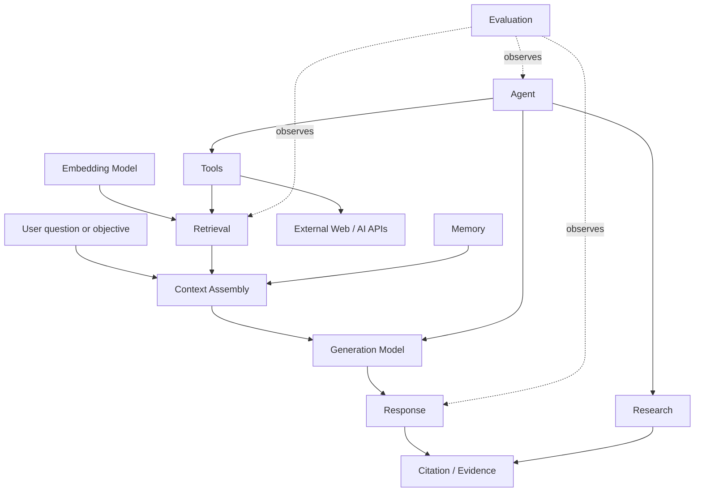
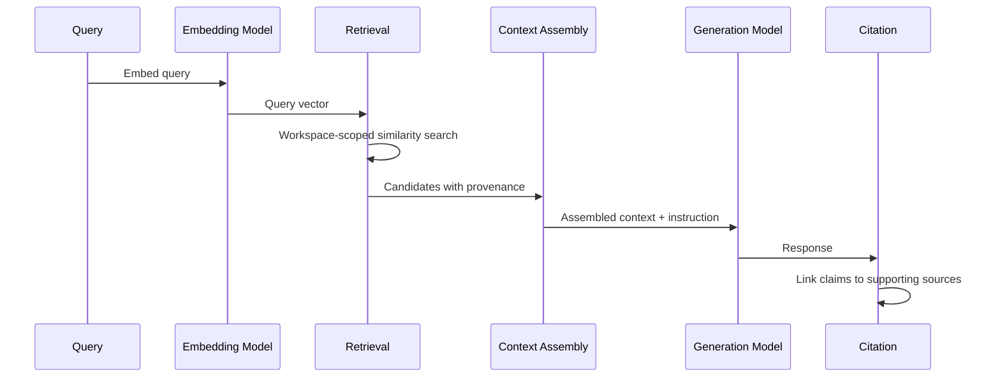
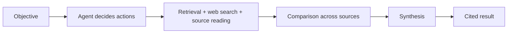

NexusAI
Architecture Documentation
Status: Approved Baseline v1

# AI Architecture

## Purpose

This document defines the AI concepts NexusAI is built on, what each one is responsible
for, and how they compose. It establishes shared vocabulary and stable boundaries so
that AI capability can be added over time without redesigning the platform.

It deliberately does **not** prescribe algorithms. Chunking strategy, reranking, agent
planning, memory algorithms and evaluation metrics are decided when the corresponding
feature is implemented.

## Scope

In scope: the AI concepts, their responsibilities, their relationships, and the
principles that govern them.

Out of scope: prompt content, model selection, parameter tuning, specific algorithms,
and provider-specific detail. Module boundaries are in `module-architecture.md`; entity
shapes are in `data-architecture.md`.

## Concept Map

RAG is the composition of Retrieval → Context Assembly → Generation, shown as a path
rather than a box.

## 1. Generation Model

**Responsibility:** produce and reason over responses in natural language, given
assembled context and an instruction.

The generation model is a capability the system calls, not the system itself. It is
reached through Spring AI so that provider choice stays behind a boundary. Nothing
architecturally depends on a specific provider or model.

The generation model is never the source of truth for factual claims about a user's
knowledge — retrieved content is. Its role in a grounded flow is to reason over supplied
evidence, not to supply evidence.

## 2. Embedding Model

**Responsibility:** convert text into vector representations that support semantic
retrieval.

Embeddings are produced during ingestion (for chunks) and at query time (for the
question), and are stored in PostgreSQL via pgvector.

Two architectural consequences:

- The embedding model is a **compatibility boundary.** Vectors produced by different
  models are not comparable. Changing the embedding model implies re-embedding the
  corpus, so which model produced a given embedding must be recorded.
- The embedding model is distinct from the generation model, chosen independently, and
  changed independently.

Dimensionality, model choice and normalization are deferred.

## 3. Retrieval

**Responsibility:** find knowledge relevant to a query, within the caller's workspace,
and return it with the provenance needed for citation.

Retrieval is a capability in its own right, not a private step of RAG. It serves grounded
answers, source browsing, the `search_knowledge()` tool, and research workflows.

Architectural requirements:

- Every retrieval is workspace-scoped. This is enforced, not conventional.
- Results carry provenance — which document, which chunk — so evidence is available
  downstream.
- Retrieval returns candidates; it does not decide what the model sees. That is context
  assembly.

Retrieval strategy beyond semantic similarity — keyword or hybrid search, reranking,
result diversification — is deferred. The boundary is positioned so such strategies can
be added inside Retrieval without changing its consumers.

## 4. RAG

**Responsibility:** retrieve relevant knowledge and supply it to the generation model,
producing an answer grounded in the user's own sources.

RAG is a composition, not a monolith. Each participant is separately replaceable.

Its defining commitment: **the answer is grounded in retrieved material, and the
supporting material is carried through to the output.** An answer produced without
retrieved support is not a RAG answer, and the system should be able to tell the
difference.

## 5. Context Assembly

**Responsibility:** select and prepare the retrieved information that will actually be
given to the model.

This is a distinct concern from retrieval because retrieval returns candidates while
context assembly must decide, under a finite context budget, which of them are included,
in what order, in what form, and alongside what other context — instructions, relevant
memory, conversation history.

Its architectural obligations:

- Preserve the link between included content and its source, so citation remains possible.
- Respect an explicit context budget rather than assuming everything fits.
- Keep sources distinguishable in the assembled context rather than merged into
  undifferentiated text.
- Never include content from outside the caller's workspace.

Selection policy, ordering, deduplication, compression and summarization strategies are
deferred.

## 6. Agent

**Responsibility:** pursue a goal — decide which actions and tools are needed, execute
them, observe results, and continue until the goal is met or abandoned.

The distinction from a single generation call: an agent runs a loop with state, makes
decisions between steps, and its path is not known in advance.

Architectural requirements:

- **Bounded.** Every agent run has explicit limits — steps, time, cost — and a defined
  termination condition, including for failure.
- **Observable.** Steps, decisions and tool invocations are recorded, so a run can be
  inspected and evaluated afterwards.
- **Scoped.** An agent operates within the workspace and permissions of the identity that
  started it. It cannot widen its own access.
- **Honest.** An agent that fails to reach its goal reports that, rather than producing a
  plausible answer without support.

Planning strategy, decomposition, retry policy and loop control are deferred.

## 7. Tools

**Responsibility:** expose explicit, bounded capabilities to AI.

Anticipated capabilities:

| Tool | Purpose |
| --- | --- |
| `search_knowledge()` | Retrieve from the workspace's own knowledge |
| `search_web()` | Find external sources |
| `read_document()` | Read a specific source in depth |
| `retrieve_source()` | Fetch a specific source or passage for evidence |
| `calculate()` | Perform deterministic computation |

Tools are the AI system's action surface, and therefore its security surface. The rules
that follow from that:

- **Explicit.** A capability exists only if it is declared as a tool. There is no
  implicit or ambient capability.
- **Contracted.** Each tool has a defined input and output contract, so results are
  interpretable and testable.
- **Scoped.** Every invocation carries the caller's workspace and permission context, and
  is enforced at invocation, not assumed from the agent.
- **Audited.** Invocations are recorded with their inputs and outcomes.
- **Bounded.** A tool does one thing. Capability breadth is added by adding tools, not by
  widening existing ones.

Tools returning external content — `search_web()`, `read_document()` on external
material — return **untrusted data**. Retrieved content is evidence to reason over, never
instruction to follow.

## 8. Memory

**Responsibility:** retain useful context from interaction across time — what the system
should carry forward about a user's ongoing work and prior exchanges.

**Memory is conceptually separate from knowledge, and stays that way.**

| | Knowledge | Memory |
| --- | --- | --- |
| Origin | User-provided sources | System's interaction history |
| Nature | Evidence | Context |
| Citable | Yes | No |
| Role in an answer | Grounds it | Informs it |
| Rebuildable | Yes, from sources | No, it is a record of interaction |

Collapsing the two produces a system that cites its own recollections as sources. Memory
may influence how a question is interpreted and what context is assembled; it may not
appear as evidence behind a claim.

Memory extraction, scoring, decay, consolidation and retrieval algorithms are deferred.

## 9. Citation and Evidence

**Responsibility:** connect generated claims and results to the sources and evidence that
support them.

This is a first-class architectural concern, not output formatting. It is why the system
is described as producing *grounded* answers rather than plausible ones.

Requirements:

- Evidence links are produced during generation, when the relationship between output and
  supporting content is known — not reconstructed afterwards by matching text.
- Citations are persisted, so a past answer remains auditable.
- Citations point at sources uniformly, whether internal documents or external material
  gathered during research (see `data-architecture.md`).
- An answer that cannot be supported should say so, rather than present an uncited claim
  as if grounded.

Granularity of citation — claim, sentence, or passage — and its presentation are
deferred.

## 10. Research

**Responsibility:** coordinate knowledge retrieval, web search, source reading,
comparison, synthesis and citation into a deep research workflow.

Research is a composition of the concepts above — Agent for execution, Tools for
capability, Retrieval for internal knowledge, Citation for evidence — organized into a
domain workflow. It is not a separate AI mechanism.

What distinguishes it from a single RAG answer: multiple sources drawn from inside and
outside the workspace, comparison across them, a longer horizon, and a persisted
evidence trail supporting the result.

Depth control, source selection and synthesis strategy are deferred.

## 11. Evaluation

**Responsibility:** measure the quality of AI behaviour.

Dimensions eventually in scope:

| Dimension | Question |
| --- | --- |
| Retrieval quality | Was the right knowledge found? |
| Relevance | Was the response on target? |
| Grounding | Was it supported by retrieved material? |
| Citation correctness | Do the citations actually support the claims? |
| Hallucination | Were unsupported claims produced? |
| Latency | How long did it take? |
| Cost | What did it consume? |
| Agent success | Did the agent achieve its goal? |

Evaluation observes AI flows; it does not participate in them. Its presence in the
baseline exists so that flows are instrumented as they are built — a system that cannot
be measured cannot be improved deliberately.

Metric definitions, datasets, scoring methods and thresholds are deferred.

## AI Principles

**Grounding over fluency.** An answer supported by the user's sources is worth more than
a confident one that is not.

**Retrieval is separable from generation.** Retrieval is useful on its own and evolves
independently.

**Evidence is produced, not reconstructed.** Support links are captured when the answer
is made.

**Capabilities are explicit.** AI acts only through declared, scoped, audited tools.

**Retrieved content is data, not instruction.** External and user-supplied content is
reasoned over, never obeyed.

**Memory informs; knowledge grounds.** The separation is maintained at every layer.

**Workspace scoping is absolute.** No retrieval, context assembly, tool call or agent
step crosses a workspace boundary.

**Models are replaceable.** Nothing architectural depends on a specific provider or model.

**Non-determinism is contained.** AI behaviour lives in named components with defined
boundaries, not spread through application services.

**Measured, not assumed.** Quality claims come from evaluation, not intuition.

## Future Extensibility

Possibilities only; not current requirements:

- Additional retrieval strategies — hybrid search, reranking — added inside Retrieval.
- Multiple generation models selected per task, behind the existing provider boundary.
- Additional tools registered through the existing Tool contract.
- Richer agent workflows built on the existing loop and tool boundaries.
- Migration to a different embedding model, supported by recording which model produced
  each embedding.
- Systematic evaluation with recorded cases, once enough real usage exists to build them
  from.

None of these requires new infrastructure. Each fits inside a boundary established here.

---

Detailed implementation decisions are intentionally deferred until the corresponding feature is implemented.
