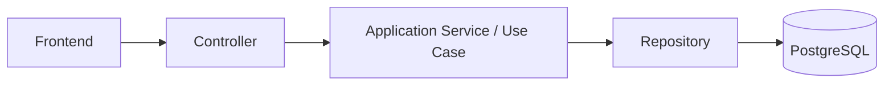
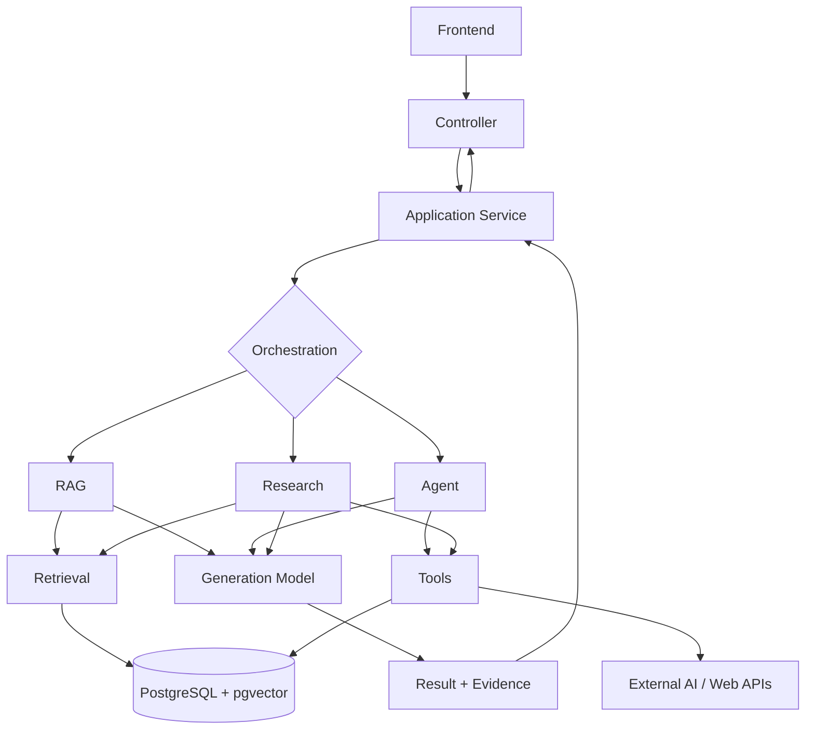
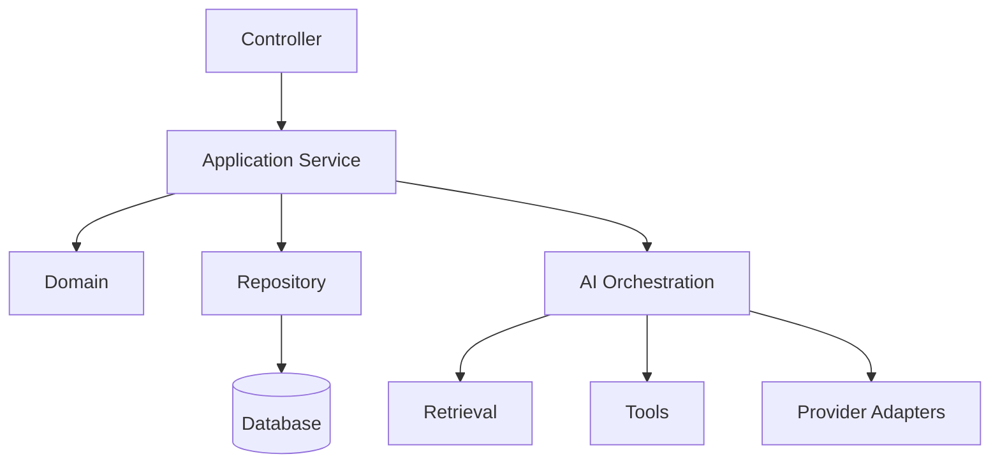

NexusAI
Architecture Documentation
Status: Approved Baseline v1

# Application Architecture

## Purpose

This document describes how work is organized *inside* the Spring Boot backend: which
kinds of components exist, how a request travels through them, and what rules govern
their interaction.

Its central position: **NexusAI is responsibility-driven, not layer-driven.** Standard
CRUD flows follow a familiar layered path. AI flows do not, and are not forced to.

## Scope

In scope:

- Component roles inside the backend
- The two primary flow shapes (data-centric and AI-centric)
- Dependency rules between components and modules
- Transaction, streaming and error posture

Out of scope:

- System topology — see `system-architecture.md`
- What each module is responsible for — see `module-architecture.md`
- Entities and their relationships — see `data-architecture.md`
- AI concept definitions — see `ai-architecture.md`

## Component Roles

| Component | Responsibility | Must not |
| --- | --- | --- |
| Controller | Accept HTTP requests, validate shape, map to/from transport representations, expose REST or SSE | Contain business rules or touch persistence |
| Application Service / Use Case | Own one unit of user intent end to end: authorization context, orchestration, transaction boundary | Know about HTTP |
| Domain component | Express rules and invariants that belong to the module's subject matter | Depend on transport or framework specifics |
| Repository | Persist and query entities | Contain business decisions |
| AI component (RAG, Agent, Research) | Orchestrate retrieval, context assembly, model calls and tool use | Bypass authorization or workspace scoping |
| Tool | Expose one explicit, bounded capability to an agent | Perform unscoped or unaudited actions |
| Provider adapter | Wrap an external model or web API | Leak provider types into application services |

## Flow Shape A — Data-Centric

The conventional path, used by modules whose work is genuinely CRUD-shaped: Auth, User,
Workspace, Document metadata, notes, and administrative operations.

Characteristics: a bounded request, a clear transaction boundary, a deterministic
result, and no model call.

## Flow Shape B — AI-Centric

Used by Chat, RAG, Agent, Research and related work. The service still owns the use case
and the authorization context, but below it sits orchestration rather than a repository.

Characteristics: multiple steps, some non-deterministic; retrieval and tool calls that
may repeat; results that carry evidence alongside content; and output that is frequently
streamed rather than returned at once.

Repositories still appear here — retrieval reads through them, conversations and
research artifacts are persisted through them — but they are one participant among
several rather than the destination of the flow.

## Why Two Shapes

Forcing an AI flow into Controller → Service → Repository produces one of two failures:
a "repository" that is really a model client and lies about what it does, or a service
that silently absorbs retrieval, context assembly, tool dispatch and evidence tracking
into an untestable mass.

Both shapes share what actually matters:

- The controller is thin and transport-only.
- The application service owns the use case and the authorization context.
- Workspace scoping is applied before any knowledge is read.
- Components below the service are replaceable without changing the controller.

## Dependency Rules

1. Dependencies point inward and downward. Nothing below a controller knows HTTP exists.
2. Controllers do not call repositories, tools or model providers directly.
3. A module's repositories and entities are internal to that module. Other modules reach
   it through its published service interface, never through its tables.
4. AI orchestration components may use retrieval and tools; they may not bypass the
   authorization context established by the calling service.
5. Provider adapters are the only place external SDK types appear.
6. Cyclic dependencies between modules are not permitted. Where two modules appear to
   need each other, one direction is expressed as an event or as an interface owned by
   the consumer.

## Cross-Module Interaction

Modules collaborate through explicit interfaces owned by the provider module. For
example, RAG asks Search for relevant knowledge; it does not query
`document_chunks` itself. Chat asks Citation to attach evidence; it does not build
citation records inline.

Where a module needs to react to something rather than request it — Knowledge reacting
to a completed ingestion, Evaluation observing a completed answer — an in-process
domain event is preferred over a direct call, so the producing module does not acquire a
dependency on its observers. This is in-process only; no message broker is part of the
current architecture.

## Transactions

- The application service is the transaction boundary for data-centric flows.
- AI flows are **not** wrapped in a single long transaction. Model and network calls
  must never hold a database transaction open. Persistence happens in short, discrete
  transactions at defined points: conversation turn recorded, chunks stored, research
  step captured.
- Long-running work (ingestion, research) is modeled as a sequence of persisted steps
  with explicit status, so that partial progress survives failure and can be reported to
  the user.

## Streaming

Streaming endpoints use SSE and follow one convention: incremental content events during
generation, followed by a terminal event carrying completion metadata — citations,
token/cost accounting, final status. Errors mid-stream are delivered as an explicit
terminal error event, never as a silently truncated stream.

The controller owns the SSE channel. The application service exposes a stream of domain
events; it does not know it is being consumed over HTTP.

## Error Handling

| Class | Handling |
| --- | --- |
| Validation | Rejected at the controller with a field-level response |
| Authorization | Uniform denial that does not reveal whether the resource exists in another workspace |
| Domain rule violation | Raised by the service or domain component, mapped once to a consistent error representation |
| External provider failure | Contained in the provider adapter, surfaced as a domain-level failure, never as a raw provider exception |
| Partial AI failure | Reported honestly — a research session that completed four of six steps reports exactly that |

## Testing Posture

- Domain rules are tested without a database or a model.
- Application services are tested against real repositories and stubbed provider adapters.
- Controllers are tested for transport concerns only.
- AI flows are tested for orchestration correctness — was retrieval scoped correctly, was
  the right tool selected, were citations attached — separately from output quality,
  which is the Evaluation module's concern.

## Architectural Principles

- Responsibility drives structure; layering is a tool, not a mandate.
- The application service is the stable unit of user intent.
- Authorization and workspace scoping are applied once, high, and never bypassed.
- Non-determinism is contained in named components rather than spread through services.
- Evidence is produced alongside answers, not reconstructed afterwards.
- Structure is added when a responsibility exists to justify it.

## Future Extensibility

Possibilities only; not current requirements:

- Moving long-running orchestration to a background executor or queue, behind the same
  service interfaces.
- Introducing a caching layer between application services and providers.
- Extracting a module into its own deployable along its existing boundary.
- Adding an alternative transport (for example bidirectional streaming) if an
  interaction genuinely requires client-to-server streaming, which none does today.

---

Detailed implementation decisions are intentionally deferred until the corresponding feature is implemented.
