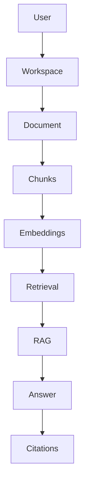
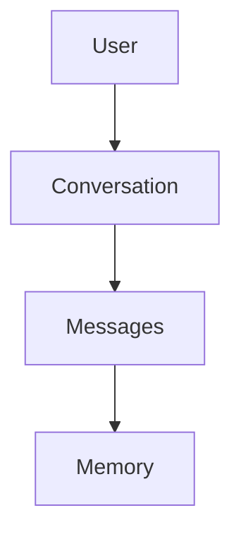
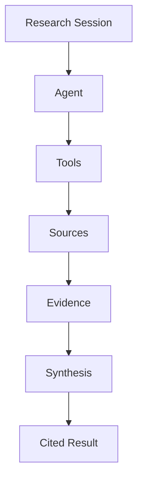
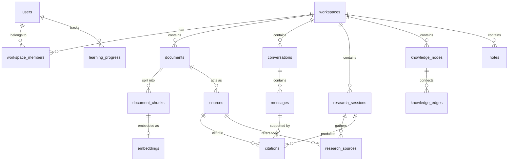

NexusAI
Architecture Documentation
Status: Approved Baseline v1

# Data Architecture

## Purpose

This document describes the **conceptual** data model of NexusAI: the main flows data
takes through the system, the entities those flows imply, and the principles governing
storage.

It is explicitly not a schema. No table, column, type, index or constraint is finalized
here. Entity names below are conceptual and will change during implementation.

## Scope

In scope: conceptual flows, likely entities and their relationships, the role of
PostgreSQL and pgvector, the boundary between structured state and stored files, and
data-level principles such as workspace scoping and provenance.

Out of scope: physical schema, migrations, indexing strategy, chunk sizing, embedding
dimensions, and retention policy — all deferred.

## Storage Decisions

**PostgreSQL is the primary relational database.** It holds the structured, durable
application and knowledge state: users, workspaces, document metadata, chunks,
conversations, messages, citations, research artifacts, knowledge structures and the
rest of the entities described below.

**pgvector provides vector storage and semantic retrieval.** Embeddings are stored in
PostgreSQL alongside the relational data that describes them.

The consequence that matters: a retrieval query can apply vector similarity *and*
workspace scoping *and* metadata filtering in a single query against a single database,
inside one consistency boundary. There is no separate vector store to keep synchronized,
and no window in which a chunk exists in one system but not the other.

**Original uploaded files are not stored in PostgreSQL.** A PDF, DOCX, image or other
uploaded binary is file content, not structured state. Originals live in file/object
storage; the database holds the document's metadata and a reference to where the
original resides.

The boundary in one line:

| Kind of data | Where it lives |
| --- | --- |
| Structured application and knowledge state — metadata, chunks, embeddings, conversations, citations, research artifacts | PostgreSQL + pgvector |
| Original uploaded binaries — PDF, DOCX, images and similar | File / object storage, referenced from PostgreSQL |

**The file storage provider is deferred.** Whether originals are kept on a local
filesystem volume, in an object store, or elsewhere is decided when document ingestion
is implemented. No provider is chosen here. What is fixed now is the boundary and the
fact that the database references the original rather than containing it.

Beyond PostgreSQL and this file storage, no other datastore is part of the current
architecture.

## Core Conceptual Flow — Knowledge

A user works within a workspace. The workspace holds documents, whose original files
live in file storage and whose metadata lives in PostgreSQL. Each document is split
into chunks. Each chunk is embedded. Retrieval selects chunks by semantic similarity
within the workspace. RAG assembles them into context and produces an answer. Citations
link the answer back to the chunks and documents that supported it.

The chain is traceable in both directions. Every answer can be walked back to the exact
chunks and source documents behind it — this is what makes evidence possible rather than
decorative.

## Conversation Flow

A user holds conversations. A conversation is an ordered sequence of messages. Memory is
derived from that interaction — durable context worth carrying forward.

Memory is derived from messages; it does not replace them. Messages are the record of
what was said; memory is what the system retains as useful. Memory is **not** knowledge
and is never cited as a source (see `module-architecture.md`).

## Research Flow

A research session gives an agent an objective. The agent invokes tools. Tools yield
sources — from the workspace's own knowledge and from the web. Sources yield evidence.
Evidence is synthesized. The synthesis is delivered as a cited result.

Each step is persisted rather than held only in memory, so a session's reasoning trail
survives, partial progress is not lost on failure, and the result remains auditable
after the fact.

## Conceptual Entity Landscape

The diagram shows likely relationships between likely entities. It is a thinking aid,
not a schema commitment.

### Likely entities

| Entity | Conceptual role | Owning module |
| --- | --- | --- |
| `users` | Account and identity | User |
| `workspaces` | Isolation boundary for all knowledge | Workspace |
| `workspace_members` | Which users may act in which workspace, and how | Workspace |
| `documents` | A registered knowledge source and its metadata | Document |
| `document_chunks` | Retrievable units of a document, with provenance | Ingestion |
| `embeddings` | Vector representation of a chunk | Ingestion |
| `conversations` | A chat thread | Chat |
| `messages` | A single turn within a conversation | Chat |
| `sources` | Anything citable — an internal document or an external source | Citation |
| `citations` | Link between a produced claim and its supporting source | Citation |
| `research_sessions` | A research objective and its lifecycle | Research |
| `research_sources` | Sources gathered during a research session | Research |
| `notes` | User-authored material within a workspace | Knowledge |
| `knowledge_nodes` | Concept or entity in the organized knowledge view | Knowledge |
| `knowledge_edges` | Relationship between knowledge nodes | Knowledge |
| `learning_progress` | Progress over material | Learning |
| `evaluation_cases` | Recorded case for measuring quality | Evaluation |

Memory has durable state but no committed entity shape at this stage; how it is
represented is deferred until Memory is built.

### Notes on the model

- **`documents` and their original files.** A document row carries metadata and a
  reference to its original file in file/object storage; the binary itself is not a
  column. The reference's form — path, key, URI — is decided with the storage provider
  when ingestion is implemented.
- **`documents` vs `sources`.** A document is an ingested artifact inside a workspace. A
  source is anything a citation can point at — which includes documents but also web
  results reached during research. Keeping them distinct lets citations be uniform
  across internal and external evidence.
- **`document_chunks` vs `embeddings`.** Kept conceptually separate because a chunk is
  content with provenance while an embedding is a representation produced by a specific
  model. A change of embedding model must not require re-deriving chunks. Whether they
  are physically one table is an implementation decision.
- **`knowledge_nodes` / `knowledge_edges`.** A graph shape over concepts derived from
  sources. Represented relationally in PostgreSQL; no graph database is part of the
  current architecture.

## Data Principles

**Workspace scoping is universal.** Every knowledge-bearing entity resolves to exactly
one workspace, and every query that reads knowledge is filtered by workspace. This is a
security control, enforced in the backend, not a convenience.

**Provenance travels with content.** A chunk carries enough information to identify the
document and the location within it. Provenance discarded during ingestion cannot be
recovered at citation time.

**Evidence is stored, not reconstructed.** Citations are persisted when an answer or
result is produced. Re-deriving which sources supported a past answer after the fact is
not reliable.

**Derived data is rebuildable.** Chunks, embeddings and knowledge nodes are derived from
source documents. The system must be able to rebuild them — after an embedding model
change, an ingestion improvement, or a corruption — without loss of user-authored data.
This is why the original file is retained in file storage and stays addressable: it is
the input re-derivation runs from.

**Schema evolves forward.** Versioned, forward-only migrations. Structure changes as
features are built; the conceptual model above is the stable part.

**Ownership follows modules.** Each entity has one owning module that writes it. Other
modules read through that module's interface, not through its tables
(see `module-architecture.md`).

## Data Lifecycle

| Stage | What happens |
| --- | --- |
| Registration | The original file is written to file storage; a document row records its metadata and storage reference in a workspace |
| Ingestion | Content is extracted from the stored original, chunked, embedded and persisted with provenance |
| Retrieval | Chunks are selected by similarity within the workspace |
| Generation | Selected chunks are assembled into context for the model |
| Evidence | Citations linking output to sources are persisted |
| Derivation | Knowledge nodes, memory and learning progress accumulate over time |
| Removal | Deleting a document removes its derived chunks and embeddings and its original file from file storage; how citations to removed sources are handled is deferred |

## Future Extensibility

Possibilities only; not current requirements:

- Additional retrieval signals stored alongside embeddings, should retrieval quality
  measurement justify them.
- Multiple embedding representations per chunk, enabling model migration without loss.
- Archival or tiering of large or cold workspaces, including their stored originals.
- A different file storage provider, reachable without changing the data model because
  the database stores a reference rather than the bytes.
- Read replicas or partitioning, if measured load ever justifies them.
- Richer knowledge graph structures within the existing relational representation.

None of these is planned work. They are noted because the conceptual model does not
foreclose them.

---

Detailed implementation decisions are intentionally deferred until the corresponding feature is implemented.
