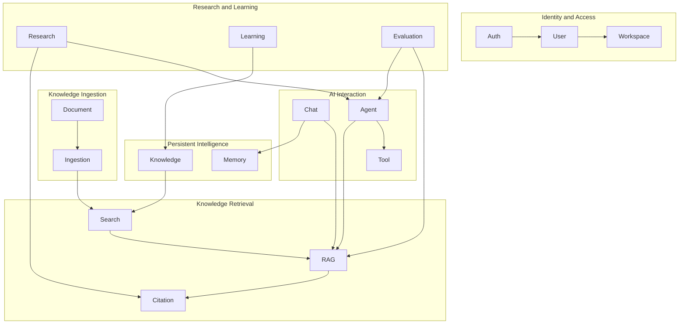
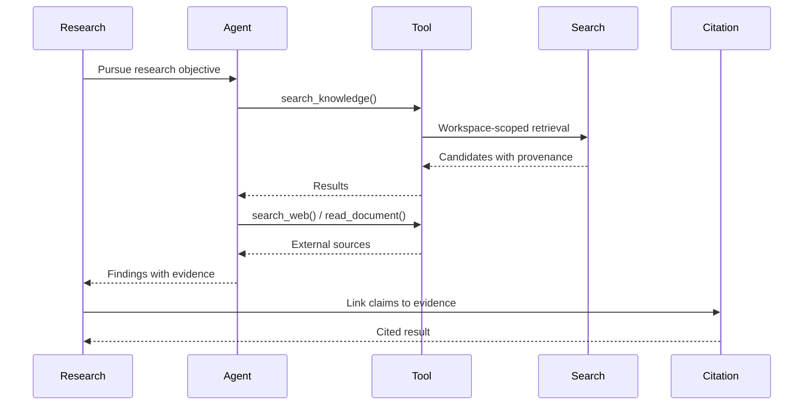

NexusAI
Architecture Documentation
Status: Approved Baseline v1

# Module Architecture

## Purpose

This document defines the modules of the NexusAI backend, what each one is responsible
for, what it deliberately does not do, and how modules relate without acquiring
unnecessary coupling.

Modules are the primary unit of structure in the modular monolith. They are the seams
along which the system can be reasoned about, changed, tested and — if ever necessary —
separated.

## Scope

In scope: module responsibilities, boundaries, dependency direction, and the role of
Workspace as an isolation boundary.

Out of scope: system topology (see `system-architecture.md`), internal class design,
database schema (see `data-architecture.md`), AI concept definitions (see
`ai-architecture.md`), and layering rules (see `application-architecture.md`).

## Module Map

Arrows show the direction of dependency: the source module uses the target module's
published interface.

## Identity and Access

### Auth

**Responsible for:** authenticating a request and establishing the security context —
credentials, sessions/tokens, and the identity attached to every downstream call.

**Not responsible for:** profile data, workspace membership decisions, or any knowledge
concern.

**Depends on:** User, for identity resolution.

### User

**Responsible for:** the user as a durable entity — profile, account state, preferences,
and the user identity that other modules reference.

**Not responsible for:** credentials (Auth) or per-workspace permissions (Workspace).

### Workspace

**Responsible for:** workspaces and their membership, and for answering the single
question every knowledge-bearing operation must ask: *may this identity act within this
workspace?*

**Not responsible for:** the content held inside a workspace.

**Why it matters:** Workspace is the knowledge and security isolation boundary of the
entire platform. Documents, chunks, embeddings, conversations, memory, research sessions
and knowledge graph nodes all belong to exactly one workspace. Retrieval never crosses
a workspace boundary. A workspace-scoped filter is not an optimization; it is the
security control that prevents one user's knowledge from reaching another's answer.

Every module that reads or writes knowledge takes the workspace context as an explicit
input and applies it. No module may treat workspace scoping as optional.

## Knowledge Ingestion

### Document

**Responsible for:** knowledge sources as first-class entities — registration, metadata,
type, origin, lifecycle and status. It is the answer to "what sources exist in this
workspace?" It also owns the reference to where a source's original file is stored, and
is the module through which other modules obtain that original.

**Not responsible for:** extracting or transforming content, or producing embeddings.

Original uploaded binaries live in file/object storage rather than in PostgreSQL; the
document record holds metadata and a storage reference. The storage provider is deferred
until ingestion is implemented (see `data-architecture.md`).

### Ingestion

**Responsible for:** turning a registered source into retrievable knowledge — reading
the stored original, extraction, splitting content into chunks, requesting embeddings,
and persisting the result with the provenance needed for later citation. It owns
ingestion status and progress reporting.

**Not responsible for:** answering queries. Ingestion produces retrievable material; it
does not retrieve.

**Depends on:** Document, and the embedding capability described in
`ai-architecture.md`.

Chunking strategy, extraction pipelines and per-format handling are deliberately
undecided at this stage.

## Knowledge Retrieval

### Search

**Responsible for:** finding relevant knowledge within a workspace and returning
candidates with the provenance attached. It is the single entry point for retrieval —
semantic, and any additional retrieval strategy adopted later.

**Not responsible for:** generation, or deciding how retrieved material is used.

**Why it is separate from RAG:** retrieval is useful on its own — browsing, source
exploration, the `search_knowledge()` tool, and research workflows all need retrieval
without generation. Collapsing Search into RAG would make retrieval unavailable to
everything that is not a RAG answer.

### RAG

**Responsible for:** the grounded-answer flow — obtaining relevant knowledge through
Search, assembling it into context, invoking the generation model, and returning an
answer together with the material that supports it.

**Not responsible for:** conversation state (Chat), tool use or multi-step goals
(Agent), or formatting citations (Citation).

### Citation

**Responsible for:** connecting produced claims and results to the sources and evidence
that support them, and for the durable representation of that link.

**Not responsible for:** producing answers, or judging their quality — that is
Evaluation.

**Why it is its own module:** citations are produced by RAG answers, by research
syntheses, and by agent results. A shared, explicit module keeps evidence handling
consistent across all three rather than reimplemented in each.

## AI Interaction

### Chat

**Responsible for:** conversational interaction — conversations, messages, turn ordering,
streaming a response to the user, and deciding when a turn needs grounded retrieval.

**Not responsible for:** retrieval mechanics (RAG/Search) or long-horizon research
(Research).

**Depends on:** RAG for grounded answers, Memory for durable interaction context.

### Agent

**Responsible for:** goal-oriented workflows — taking an objective, deciding which
actions and tools are needed, executing them, observing results, and continuing until
the goal is met or abandoned. It owns the execution loop and its termination.

**Not responsible for:** implementing capabilities (Tool), or the research domain
workflow (Research).

Planning strategy and loop control are deliberately undecided.

### Tool

**Responsible for:** the registry of explicit capabilities exposed to AI, their
contracts, their invocation, and the enforcement of workspace scope and permission on
every call.

Capabilities anticipated at this stage:

| Tool | Purpose |
| --- | --- |
| `search_knowledge()` | Retrieve from the workspace's own knowledge |
| `search_web()` | Find external sources |
| `read_document()` | Read a specific source in depth |
| `retrieve_source()` | Fetch a specific source or passage for evidence |
| `calculate()` | Perform deterministic computation |

**Not responsible for:** deciding *when* a tool is used — that is Agent.

**Why it is separate from Agent:** tools are the security surface of the AI system. A
distinct module keeps every capability declared, scoped and auditable in one place, and
lets tools be used outside an agent loop.

## Persistent Intelligence

### Memory

**Responsible for:** durable, useful context derived from interaction — what the system
should carry forward about a user's ongoing work, preferences and prior exchanges.

**Not responsible for:** storing source knowledge.

**The separation from Knowledge is deliberate and load-bearing.** Knowledge is what the
user's sources say; it is evidence, and it is citable. Memory is what the system has
learned from interacting; it is context, and it is not evidence. Blurring the two
produces answers that cite the system's own recollections as if they were sources.
Memory informs; Knowledge grounds.

### Knowledge

**Responsible for:** the organized, structured view of what a workspace knows —
concepts, entities, and relationships derived from ingested sources, held as knowledge
nodes and edges. It is the layer above raw chunks that supports organization,
navigation and connection.

**Not responsible for:** raw storage of chunks and embeddings (Ingestion/Search), or
conversational context (Memory).

## Research and Learning

### Research

**Responsible for:** the deep research workflow — a research session with a question,
coordinating knowledge retrieval, web search, source reading, comparison and synthesis,
and producing a cited result with its supporting evidence trail preserved.

**Not responsible for:** the agent execution loop (Agent), tool implementation (Tool),
or citation representation (Citation). Research composes these into a domain workflow.

### Learning

**Responsible for:** helping the user learn from their own knowledge — progress over
material, and the structures that support revisiting and consolidating it.

**Depends on:** Knowledge and Document.

This module is the least developed at this stage; its boundary is reserved so that
learning features do not later land inside Chat or Knowledge by default.

### Evaluation

**Responsible for:** measuring system quality — eventually retrieval quality, relevance,
grounding, citation correctness, hallucination, latency, cost and agent success.

**Not responsible for:** producing answers. It observes flows; it does not participate
in them.

**Why it exists in the baseline:** an evaluation boundary that is present from the start
means AI flows can be instrumented as they are built. Which metrics are computed, and
how, is deliberately undecided.

## Relationships Without Coupling

The rules that keep the module map from degenerating into a tangle:

1. **Interface, not internals.** A module is reached through its published service
   interface. Its entities, repositories and tables are private to it. No module queries
   another module's tables.
2. **One direction.** Dependencies flow from higher-level workflow modules toward
   lower-level capability modules — Research → Agent → Tool, Chat → RAG → Search.
   Capability modules never depend on their consumers.
3. **No cycles.** Where mutual need appears, one direction becomes an in-process domain
   event, or an interface owned by the consumer.
4. **Composition over absorption.** Research uses Agent, Citation and Search rather than
   reimplementing them. Chat uses RAG rather than retrieving itself.
5. **Workspace context is explicit.** It is passed as an input, never inferred from
   ambient state, and never treated as optional.
6. **Shared concepts live in one module.** Citation is the single owner of evidence
   linkage; Tool is the single owner of capability contracts.

### Illustrative composition

No module in this flow reaches past its neighbour, and each could be changed
independently.

## Architectural Principles

- Modules are defined by responsibility, not by technical layer.
- Workspace is a security boundary; scoping is mandatory everywhere knowledge is touched.
- Memory and Knowledge are conceptually distinct and remain so.
- Retrieval is separable from generation.
- Capabilities exposed to AI are explicit, bounded and auditable.
- Evidence is a first-class output, not a formatting step.
- Module boundaries are stable; module internals are free to change.

## Future Extensibility

Possibilities only; not current requirements:

- New tools registered through the existing Tool contract without touching Agent.
- Additional retrieval strategies added inside Search without changing RAG, Chat or
  Research.
- Learning and Evaluation growing into substantial modules along boundaries reserved now.
- A module extracted into a separate deployable along its existing boundary, should real
  scaling or lifecycle pressure ever justify it.

---

Detailed implementation decisions are intentionally deferred until the corresponding feature is implemented.
