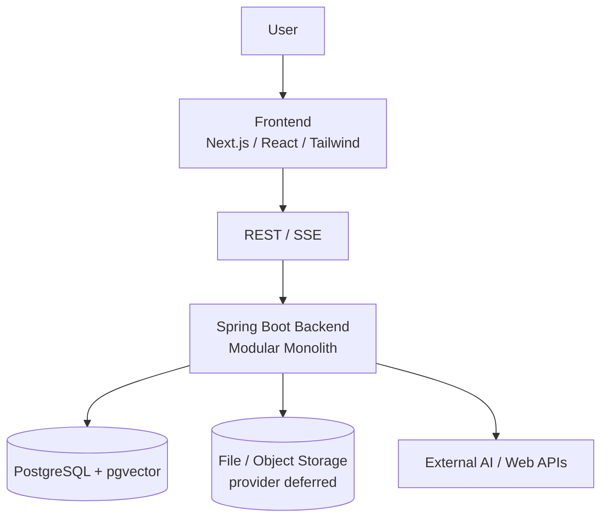
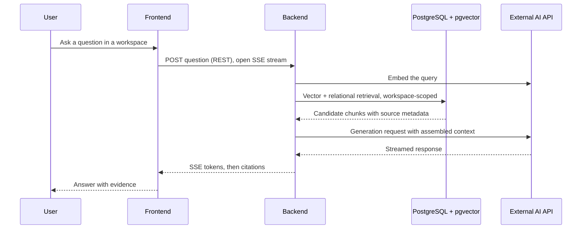
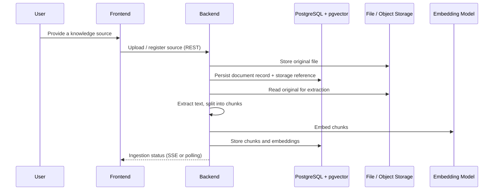
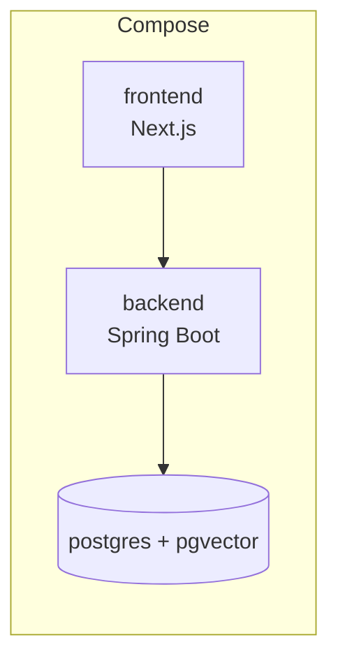

NexusAI
Architecture Documentation
Status: Approved Baseline v1

# System Architecture

## Purpose

This document describes the overall shape of the NexusAI system: its major runtime
participants, how they communicate, where state lives, and which architectural style
governs the platform at this stage.

NexusAI is an AI-powered personal knowledge and research platform. Users supply
knowledge sources, organize and retrieve that knowledge, ask questions grounded in it,
receive evidence and citations, and — as the platform matures — run deeper research
workflows driven by AI agents and tools.

NexusAI is not a PDF chatbot. Retrieval-augmented question answering is one capability
inside a broader knowledge and research system.

## Scope

In scope for this document:

- System-level components and their boundaries
- Communication style between frontend, backend and data
- The modular monolith decision and its consequences
- External dependencies and where they attach
- Deployment shape for local development

Out of scope (covered elsewhere):

- Internal layering rules — see `application-architecture.md`
- Module responsibilities — see `module-architecture.md`
- Conceptual data model — see `data-architecture.md`
- AI concepts and vocabulary — see `ai-architecture.md`

## Technology Baseline

| Concern | Technology |
| --- | --- |
| Frontend | TypeScript, React, Next.js, Tailwind CSS |
| Backend | Java 21, Spring Boot, Spring Data JPA, Spring Security, Spring AI |
| Database | PostgreSQL with the pgvector extension |
| File / object storage | Required for original uploaded files; provider deferred |
| Infrastructure | Git, GitHub, Docker / Docker Compose |
| Communication | REST APIs, SSE where streaming is appropriate |
| Architecture style | Modular monolith |

File/object storage appears as a *requirement without a chosen provider*. The system
needs somewhere to keep original uploaded binaries; which mechanism serves that role is
deliberately undecided until document ingestion is implemented.

Nothing outside this table is a current dependency. Microservices, Kubernetes, Kafka,
Redis and comparable infrastructure are explicitly **not** part of the current
architecture. Where such technologies appear in these documents they appear only under
future extensibility, as possibilities to be evaluated if and when a real constraint
demands them.

## High-Level Structure

### User

A person working inside a workspace: uploading sources, asking questions, reading cited
answers, and running research sessions.

### Frontend

A Next.js/React application in TypeScript, styled with Tailwind CSS. It owns
presentation, client-side navigation, and the interaction model for chat, documents and
research. It holds no business rules of its own; it renders state produced by the
backend and streams incremental AI output over SSE.

### Communication Layer

REST is the default. Requests that produce incremental output — token-by-token chat
responses, progress from a long-running research session, ingestion status — use
Server-Sent Events. SSE is chosen deliberately: the streams are server-to-client and
unidirectional, which does not justify a bidirectional protocol.

### Backend

A single Spring Boot application containing every business and AI module. It owns
authentication, authorization, persistence, retrieval, AI orchestration and all
integration with external providers. It is the only component permitted to talk to the
database, to file storage, or to external AI and web APIs.

Modules within the backend:

| Group | Modules |
| --- | --- |
| Identity and access | Auth, User, Workspace |
| Knowledge ingestion | Document, Ingestion |
| Knowledge retrieval | Search, RAG, Citation |
| AI interaction | Chat, Agent, Tool |
| Persistent intelligence | Memory, Knowledge |
| Research and learning | Research, Learning, Evaluation |

Their individual responsibilities and relationships are documented in
`module-architecture.md`.

### Database

PostgreSQL is the primary store for structured, durable application and knowledge
state: users, workspaces, document metadata, chunks, conversations, messages, citations,
research artifacts and knowledge structures. Through the pgvector extension it also
holds the embedding vectors used for semantic retrieval.

Keeping vectors in the same database as relational data is a deliberate simplification.
It means retrieval can filter by workspace, document and metadata in the same query that
performs vector similarity, with one transactional boundary and no separate vector
service to operate.

PostgreSQL is not where original uploaded binaries live. That is a separate concern,
described next.

### File / Object Storage

Original uploaded files — PDFs, DOCX, images and whatever other formats are supported —
are binary content, not structured state. They are stored as files/objects, separate
from PostgreSQL. The database holds a document's metadata and a reference to where its
original file resides; it does not hold the bytes.

The separation matters for three reasons: binaries are large and would bloat the
relational store and its backups; they are written once and read rarely, which is a
different access pattern from the rest of the data; and ingestion derives chunks and
embeddings *from* the original, so keeping the original addressable independently is
what makes re-ingestion possible.

**The provider and implementation are deferred.** Whether original files are kept on a
local filesystem volume, in an object store, or elsewhere is decided when document
ingestion is implemented. No specific provider is chosen or assumed here. What the
architecture commits to now is only the boundary: structured state in PostgreSQL,
original binaries in file/object storage, with the database referencing the latter.

### External AI and Web APIs

Generation models, embedding models and (for research) web search and retrieval
services are external. The backend reaches them through Spring AI and through explicit
tool implementations, so that provider choice remains an implementation detail behind a
module boundary rather than a system-wide assumption.

## Request Flows

### Grounded question answering

### Source ingestion

## Architectural Principles

**Modular monolith.** One deployable unit, internally divided by strong module
boundaries. This gives the boundary discipline of a distributed system without its
operational cost — no service mesh, no distributed transactions, no cross-service
debugging. If a module later genuinely needs independent scaling or deployment, its
boundary is already the seam along which it can be extracted.

**The backend owns the truth.** The frontend never talks to the database, never holds
API credentials for AI providers, and never enforces authorization. Every rule that
matters is enforced server-side.

**Workspace is the isolation boundary.** Every piece of knowledge, every conversation
and every research artifact belongs to a workspace. Retrieval, generation and tool
access are scoped to the caller's workspace. This is a security boundary, not only an
organizational one.

**Responsibility-driven structure.** Modules are separated by what they are responsible
for, not by technical layer. A uniform layering scheme is not imposed on modules whose
work does not fit it.

**Minimal infrastructure.** The system runs on a database, file storage, an application
and a frontend. Additional infrastructure must be justified by a real, observed
constraint.

**Just-in-time technical depth.** Boundaries and responsibilities are fixed now.
Algorithms, schemas and provider-specific details are decided when the corresponding
feature is built.

## Deployment Shape

Local development runs through Docker Compose:

Three containers, one network, one command to start. The same composition shape carries
to a single-host deployment. External AI and web APIs are reached over the network and
are not part of the composition.

Where original uploaded files are kept in local development — a mounted volume, a
container, or something else — is settled together with the storage provider when
document ingestion is implemented, and is deliberately not fixed here.

## Cross-Cutting Concerns

| Concern | Position at this stage |
| --- | --- |
| Authentication | Spring Security in the backend; the frontend holds no authorization logic |
| Authorization | Workspace membership checked on every knowledge-bearing operation |
| Configuration | Environment-driven; no provider credentials in the frontend or in source control |
| Observability | Application logging plus the metrics the Evaluation module will define |
| Error handling | Consistent REST error representation; SSE streams carry explicit terminal error events |
| Schema evolution | Versioned, forward-only database migrations |

Specific libraries, token formats, log shipping and metric backends are deferred.

## Future Extensibility

These are possibilities, **not** current requirements, and none of them is a dependency
today:

- **Asynchronous processing.** Ingestion and research are long-running. If in-process
  execution becomes limiting, a queue or a dedicated worker process is the natural next
  step — the Ingestion and Research module boundaries already contain that work.
- **Caching.** If retrieval or generation cost becomes a measured problem, a cache can
  be introduced behind existing module interfaces.
- **Service extraction.** A module under genuinely different load or lifecycle pressure
  can be extracted along its existing boundary.
- **Alternative model providers.** Provider access sits behind module boundaries, so
  additional or swapped providers do not ripple through the system.
- **Horizontal scale.** The backend keeps structured state in PostgreSQL and original
  files in file storage rather than in application memory or on a single instance's local
  disk, which keeps multi-instance deployment open.
- **File storage provider.** The provider is chosen at ingestion time; because the
  database stores a reference rather than the bytes, changing that choice later does not
  disturb the data model.

Each of these is deliberately unbuilt. The architecture makes them reachable; it does
not pay for them in advance.

---

Detailed implementation decisions are intentionally deferred until the corresponding feature is implemented.
